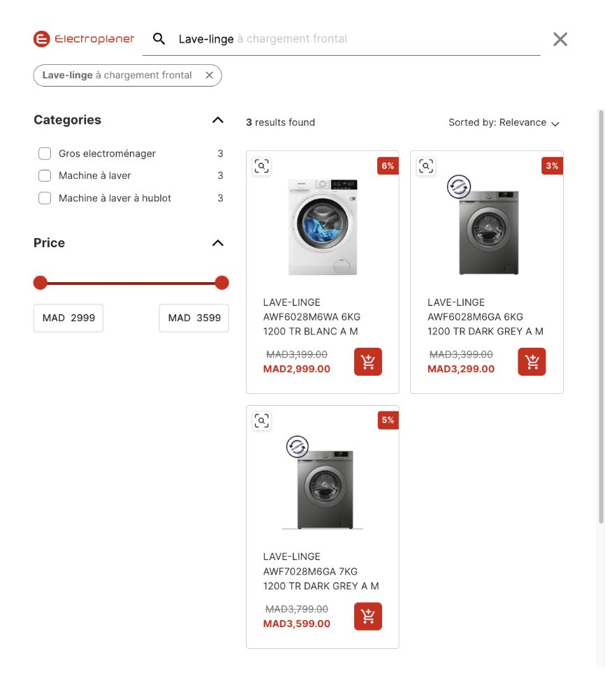
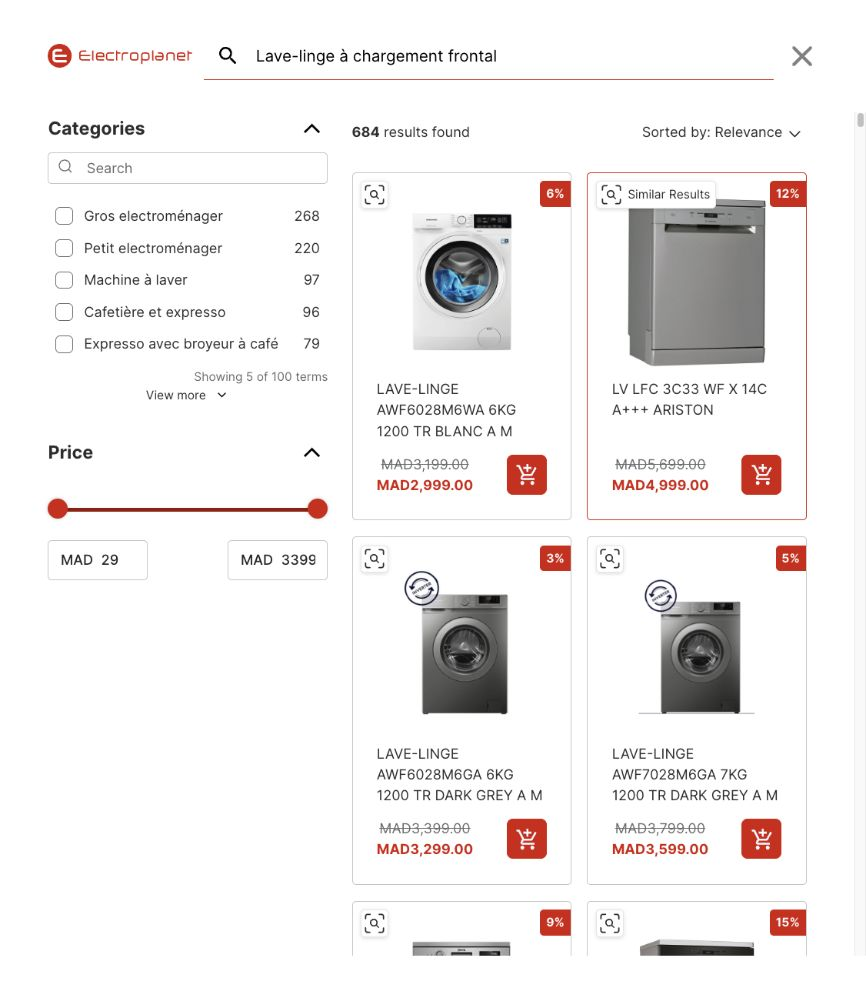

# electroplanet 0건 판정 정정과 재수집

확인일: 2026-10-29 한국 시간. 사용자가 상품이 나오는 내부 브라우저 화면을 제시해 재검증했다. **이전의 ‘모로코 원문 9개 전부 0건’ 결론을 철회한다.**

## 왜 0건으로 기록됐는가

1. `검색어_점검_20261026.csv`의 모로코 9행은 `/recherche?q=…` 페이지에 나온 `Votre recherche n’a donné aucun résultat.`를 근거로 0건·검색어안먹힘으로 기록됐다. 당시 기록은 네덜란드 VPN 접속이었다.
2. 10월 28일 수집 준비에서는 이 점검과 ‘원문 0건 11행 제외’ 지시를 이어받아 모로코 9행을 재검색하지 않고 제외했다. 정정 전 `검색어별_진행.json`의 사유는 `사용자 지정 원문 0건 11행; 2026-10-26 점검 근거. 변형 검색어 수집 안 함`이었다.
3. 10월 29일 모로코 VPN·로컬 Chrome에서도 `/recherche` 화면의 0건을 다시 관찰했다. 하지만 **검색창 입력 중 열리는 별도 전체화면 검색(`#ada2/fullscreen/…`)을 확인하지 않은 채 사이트 전체 결과가 없다고 일반화한 것이 AI의 확인 오류**였다. 내부 브라우저와 Chrome의 차이 또는 VPN만을 원인으로 확정하지 않는다.

정정 전 CSV·진행 JSON·검증 결과는 [정정 전 보존 폴더](모로코정정전_19714eb1/)에 남겼다. 10월 29일 앞선 내부 브라우저의 502·503 오류는 별도 접속 오류이며, 검색 결과 0건의 근거가 아니다.

## 어떻게 해결했는가

- 사용자가 연 **Search 전체화면 검색창**에 엑셀 J열 원문을 그대로 입력했다. 입력한 원문과 최종 URL의 `q` 값도 대조했다. 하이픈·악센트·띄어쓰기·대소문자를 바꾸지 않았고, 제안 검색어나 검색 방식 매개변수를 수동 선택·변경하지 않았다.
- 예: [전체화면 Lave-linge 검색](https://www.electroplanet.ma/#ada2/fullscreen/m=and&q=Lave-linge)에는 `3 results found`와 일반 상품 카드 3개가 나왔다. 이전 [별도 recherche 페이지](https://www.electroplanet.ma/recherche?q=Lave-linge)의 0건만으로 원문 검색 결과가 없다고 결론 낼 수 없다.
- 표시된 전체 수까지 상품 목록을 스크롤하고 최종 누적 카드의 이름·링크·순서를 저장했다. `WashTower`의 `No results found` 아래 **Recommended products 10개는 본 검색 목록이 아니므로 제외**했다. 할인율 표시를 광고 표시로 간주하지 않았다.
- 접속 시 Proton VPN 화면에서 모로코 MA#37 연결을 확인했다. 이 작업 중 CAPTCHA 해결·유료 호출·PDP 상세 방문은 하지 않았다.

**확인하지 못한 것:** `/recherche`와 전체화면 검색의 서버 내부 처리·색인·검색 방식이 왜 다른지는 확인하지 못했다. URL에 나타난 `m=f`, `m=or`, `m=and`의 내부 의미도 확정하지 않는다. 이번 해결은 실제 전체화면 검색 경로에서 결과를 확인하고 수집한 것이며, 사이트 오류를 고친 것은 아니다.

## 표시 수와 최종 저장 수 대조

| 엑셀 행 | J열 원문 | 표시 결과 | 저장한 본 목록 카드 | 결과 |
| ---: | --- | ---: | ---: | --- |
| 387 | Réfrigérateurs | 116 | 116 | 일치 |
| 388 | Réfrigérateurs Multi-portes | 29 | 29 | 일치 |
| 389 | Réfrigérateurs Combinés | 129 | 129 | 일치 |
| 390 | Réfrigérateurs Deux portes | 29 | 29 | 일치 |
| 391 | Réfrigérateurs Side by side | 23 | 23 | 일치 |
| 392 | Lave-linge | 3 | 3 | 일치 |
| 393 | Lave-linge à chargement frontal | 684 | 684 | 일치 |
| 394 | WashTower | No results found | 0 | 실제 0건, 추천 제외 |
| 396 | sèche-linge | 4 | 4 | 일치 |
| 합계 | 9개 원문 | — | 1,017 | 8개 결과 있음·1개 0건 |

브랜드·제품군·리리부·URL 중복 제거는 적용하지 않았다. 다른 검색어에서 같은 URL이 다시 나와도 각각 보존했다. 무한 스크롤 중 URL의 `p` 값이 바뀌었으며, 카드 CSV의 페이지번호는 **최종 누적 화면의 실제 `p` 값**이다(예: 393행은 35). 상품별 최초 로딩 페이지는 기록하지 않았다. 빠른 스크롤 중 관찰한 `p` 값은 일부 건너뛰므로 개별 페이지를 모두 별도 저장했다고 주장하지 않으며, 표시 수와 최종 누적 카드 수를 대조했다.

## 반영 파일과 검증

- [상품카드.csv](상품카드.csv): 기존 42,854행을 그대로 보존하고 모로코 1,017행을 추가해 **43,871행**. 고유 URL 수가 아니다.
- [검색어별_건수대조.csv](검색어별_건수대조.csv), [검색어별_진행.json](검색어별_진행.json), [리테일러별_요약.csv](리테일러별_요약.csv), [페이지넘김_조사.csv](페이지넘김_조사.csv): 모로코 9행의 제외·0건 판정과 검색 경로를 정정했다. [10월 26일 점검 CSV](../검색어_점검_20261026.csv)도 모로코 9행에 정정 날짜·근거를 명시했다. 제품 혼입 유형 자체의 재분류는 하지 않았다.
- [실패목록.csv](실패목록.csv): **기존 헝가리 7행·포르투갈 4행의 수 불일치 11행은 그대로 남아 있다.** 이번 모로코 수집에서 새 실패는 없지만 전체 작업의 실패가 0건인 것은 아니다.
- [모로코 재수집 건수 대조 CSV](모로코_재수집_건수대조_20261029.csv), [최종 누적 카드 원본](모로코_전체화면_최종수집_19714eb1.json), [스크롤 중간 원본](모로코_전체화면_수집원본_19714eb1.jsonl), [정정 검증 JSON](모로코_정정검증_19714eb1.json)에 상세를 남겼다. 공통 `상품카드_페이지원본.jsonl`에도 9개 최종 누적 화면을 추가했으며 기존 원본은 지우지 않았다.
- 검증 명령: 묶음 Python 실행기의 `/tmp/lg_morocco_19714eb1.py`, 페이지 메타데이터 정정 `/tmp/lg_morocco_page_metadata_19714eb1.py`, 최종 대조 `python3 /tmp/lg_verify_morocco_final_19714eb1.py`. EY 원본 126행 메타데이터·J열 일치, 모로코 9개 URL 검색어·표시 수·카드 수·순번·링크·최종 URL의 p값 일치, 다른 117개 검색어와 기존 42,854개 카드 불변, 실패 CSV 불변을 검사했다. 페이지값 처리의 가짜 URL 2개도 검사했다. 결과: **43,871카드 / 끝 도달 97행 / 상한 적용 15행 / 원문 0건 3행 / 수 불일치 11행**. 남은 0건 중 폴란드 137행·이집트 376행은 과거 지정 근거이며 이번에 재검증하지 않았다.

